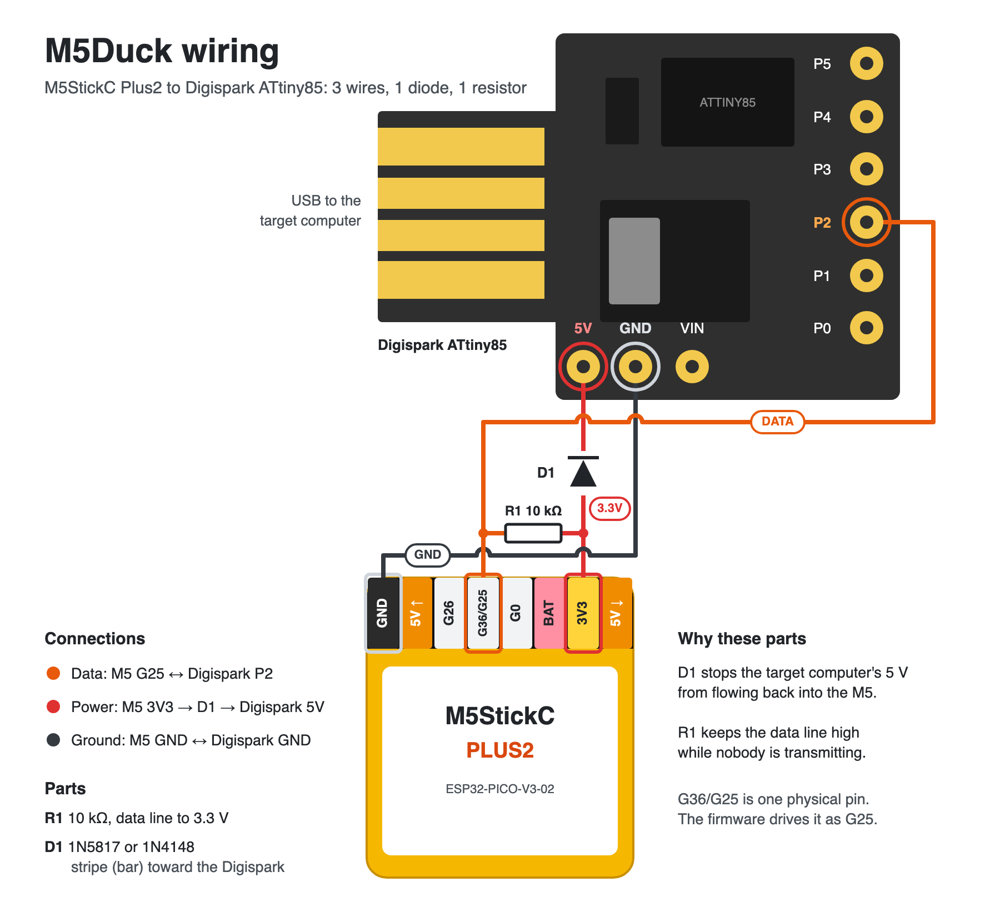
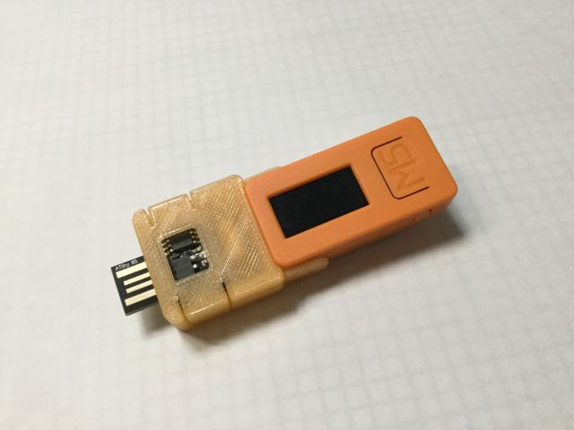

# M5Duck

Run the same keystrokes on many computers, one plug at a time.

An M5StickC Plus2 holds your scripts and feeds them, line by line, to a Digispark (ATtiny85). The Digispark types each line on the computer it is plugged into, as a USB keyboard. Plug it into the next machine, press a button, repeat.

## How it works

```
 M5StickC Plus2  ──── one data wire ────  Digispark  ──── USB ────  target computer
 (holds scripts)       (half-duplex)      (types keys)
```

The Digispark stores nothing. It has to stay wired to the M5 the whole time it is plugged into the target computer.

1. Each `.txt` file in `scripts/` is a script, stored in the M5's flash. Example: `scripts/browser.txt`.
2. The M5 screen lists the scripts by name. The side buttons move the selection, the front button (M5) runs it.
3. The M5 waits ("Aguardando") and sends nothing yet. The front button cancels.
4. When the Digispark is plugged into a computer and the USB handshake finishes, it tells the M5 over the data wire. Only then does the M5 start sending.
5. The M5 sends one line, the Digispark types it, then answers "ok" on the same wire. Only after that "ok" does the M5 send the next line.
6. Unplug the Digispark from the computer and it goes back to waiting. To run on another machine, start again from step 2.

## What you need

| Part | Notes |
|---|---|
| M5StickC Plus2 | Runs the scripts |
| Digispark ATtiny85 | Types them |
| 1 resistor, ~10 kΩ | Pull-up on the data wire |
| 1 diode (1N5817 or 1N4148) | In series on the power wire, see below |
| Jumper wires | 3 wires between the boards |
| [PlatformIO](https://platformio.org/install) | To build and flash both boards |

## Wiring



| Signal | M5StickC Plus2 | Digispark | Notes |
|---|---|---|---|
| Data (both directions) | G25 | P2 | ~10 kΩ pull-up from this wire to 3.3 V, so the line stays high when nobody is transmitting. |
| Power | 3.3 V | VCC / 5V | Diode in series, anode on the M5 side, cathode on the Digispark side. |
| Ground | GND | GND | Required, otherwise the data signal does not work. |

**Why the diode is required.** While the Digispark is only connected to the M5, it runs on the M5's 3.3 V. When you plug it into a computer, that USB port also pushes 5 V into the same power wire. Without the diode, the 5 V flows back into the M5 and destabilizes its power, and the screen flickers. The diode lets power go from the M5 to the Digispark and blocks the way back.

The M5 power only keeps the Digispark alive while it receives and types. The USB link to the computer is powered by the computer.

Without the pull-up, the line can float while idle and both sides read garbage.

## 3D-printed case (optional)



The `case-3d/` folder holds [Digispark HAT for M5StickC](https://www.thingiverse.com/thing:4045319) by [n602](https://www.thingiverse.com/n602/designs) on Thingiverse. It holds the Digispark on the back of the M5 so the pair travels as one piece. It is based on a write-up by Masayuki Tanaka at [Lang-Ship](https://lang-ship.com/blog/?p=1219).

Before printing, note two differences from this project:

- The original wiring uses M5 G0 to Digispark P0 and G26 to P2. M5Duck uses G25 to P2 for data. Wire the case following the diagram above.
- The design was made for the M5StickC, not the Plus2. Check the fit before printing.

## Build and flash

M5 firmware, from the repository root:

```
pio run -t upload
pio run -t uploadfs
```

`upload` flashes the firmware. `uploadfs` flashes the contents of `scripts/` into the M5's memory. Run `uploadfs` again every time you change a script.

Digispark firmware, from `digispark/`:

```
pio run -t upload
```

PlatformIO asks you to plug in the Digispark when it is ready to flash.

## Writing scripts

See [SCRIPTS.md](SCRIPTS.md) for the format, limits and examples.

## Project layout

| What | Where |
|---|---|
| M5 firmware | `platformio.ini`, `src/main.cpp` |
| Digispark firmware | `digispark/platformio.ini`, `digispark/src/main.cpp` |
| USB keyboard library for the Digispark | `digispark/lib/DigisparkKeyboard` |
| Scripts | `scripts/*.txt` |
| Wiring diagram | `docs/wiring.png` |
| 3D-printed case (third-party) | `case-3d/` |

## Known limits

- Keyboard layout is fixed to US International (it comes from the Digispark library).
- The Digispark has to stay wired to the M5 (data and power) the whole time it is plugged into the target. You cannot unplug it from the M5 and carry it alone.
- "Plugged into the computer" is detected by the USB handshake. On hubs or ports that take long to enumerate, the wait on the M5 can last a few extra seconds. That is normal.
- Up to 30 scripts, 16 KB each. More details in [SCRIPTS.md](SCRIPTS.md).
- Messages on the M5 screen are in Portuguese.

## License

GNU GPL v3, see [LICENSE](LICENSE), for everything except `case-3d/`.

`case-3d/` is the work of n602 and keeps its own license, Creative Commons Attribution-NonCommercial-ShareAlike (see `case-3d/LICENSE.txt`). It is not covered by the GPL, and it does not allow commercial use.

## Credits

The Digispark keyboard library bundles [V-USB](https://www.obdev.at/vusb/) by Objective Development, which is distributed under the GNU GPL v2 or v3. Its license texts are kept in `digispark/lib/DigisparkKeyboard`.
